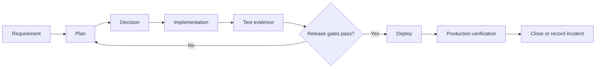

# FaithQuest Home

> [!important] Current objective
> Prepare FaithQuest for safe multi-user use. Supabase must become the authoritative data store before real operational data is entered.

## Start here

- [[Project Status]] — what works, what is blocked, and what comes next
- [[../01 - Product/Product Vision|Product Vision]] — who the system serves
- [[../02 - System/System Overview|System Overview]] — how the application works
- [[../03 - Database/ERD|ERD]] — database relationships
- [[../06 - Quality/System Audit|System Audit]] — evidence-based system review
- [[../06 - Quality/Findings Register|Findings Register]] — prioritized repair list
- [[../07 - Planning/Current Sprint|Current Sprint]] — approved work in progress
- [[../08 - Decisions/Decision Log|Decision Log]] — important technical decisions
- [[../09 - Evidence/Test Results|Test Results]] — verification evidence

## Truth boundaries

| Evidence | What it proves |
|---|---|
| Product intent | What FaithQuest should do |
| Source code | What is implemented in the repository |
| Local evidence | What passed on this computer |
| Production evidence | What passed on Vercel and Supabase |
| User acceptance | What real users approved |

Never treat one evidence level as proof of another.

## Development loop

## Quick actions

- New feature: use [[../90 - Templates/Feature Template|Feature Template]]
- New bug: use [[../90 - Templates/Bug Report Template|Bug Report Template]]
- New decision: use [[../90 - Templates/Decision Template|Decision Template]]
- New test: use [[../90 - Templates/Test Case Template|Test Case Template]]
- Production problem: use [[../90 - Templates/Incident Template|Incident Template]]
