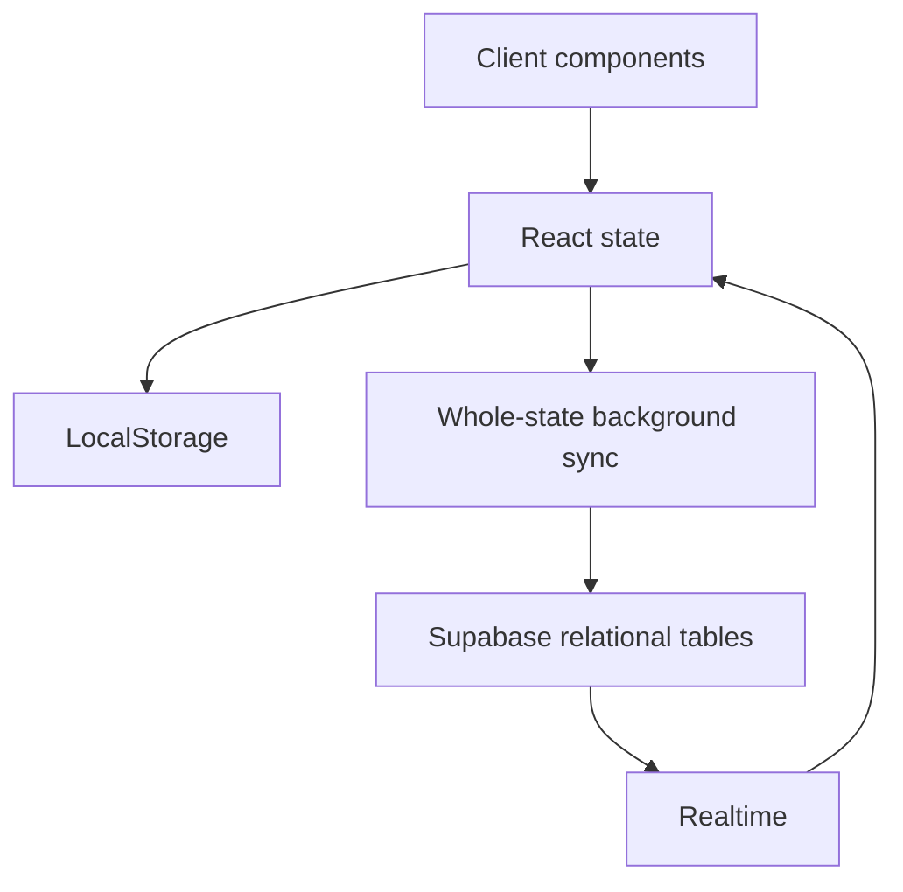
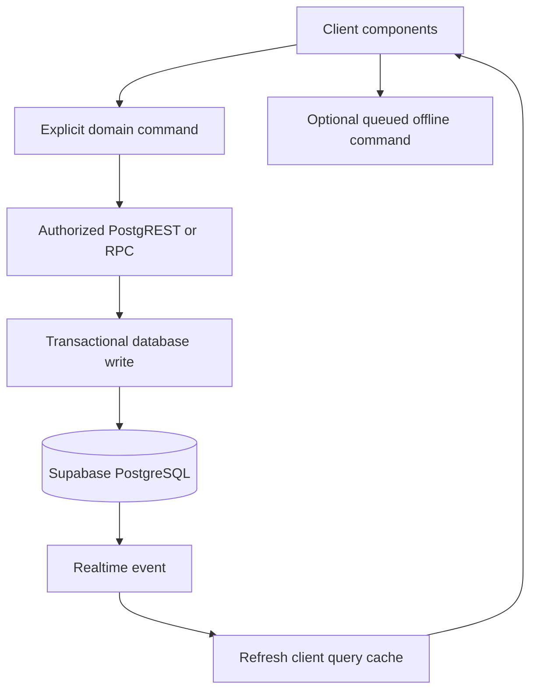

# System Architecture

## Current

Risks: partial synchronization, silent write failures, stale deletions, and last-writer-wins conflicts.

## Target

## Design rules

1. PostgreSQL is authoritative.
2. RLS enforces ownership regardless of UI behavior.
3. Multi-row operations use transactions or RPC functions.
4. Failed writes remain visible and retryable.
5. Realtime updates refresh authorized data, not entire browser snapshots.
