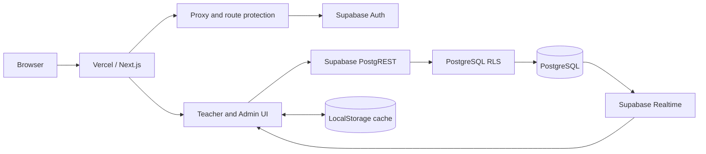

# System Overview

FaithQuest is a Next.js 16 application deployed on Vercel. Supabase provides authentication, PostgreSQL, Row-Level Security, and Realtime updates.

## Current architecture concern

The classroom treats browser state and Supabase as competing data sources. The target architecture makes Supabase authoritative and limits browser storage to an explicit offline cache.

## Related notes

- [[Repository Map]]
- [[System Architecture]]
- [[System Flow]]
- [[Authentication Flow]]
- [[Data Synchronization]]
- [[Multi-User Design]]
