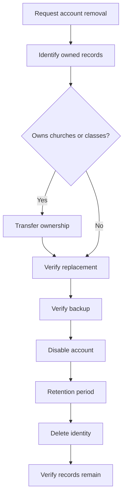

# Account Deletion

## Current risk

The source migration uses cascading deletes from profiles to churches and teacher classes. Deleting an Auth user may therefore remove its profile and dependent operational records.

## Required deletion flow

Production deletion requires explicit scope, backup evidence, and rollback instructions.
